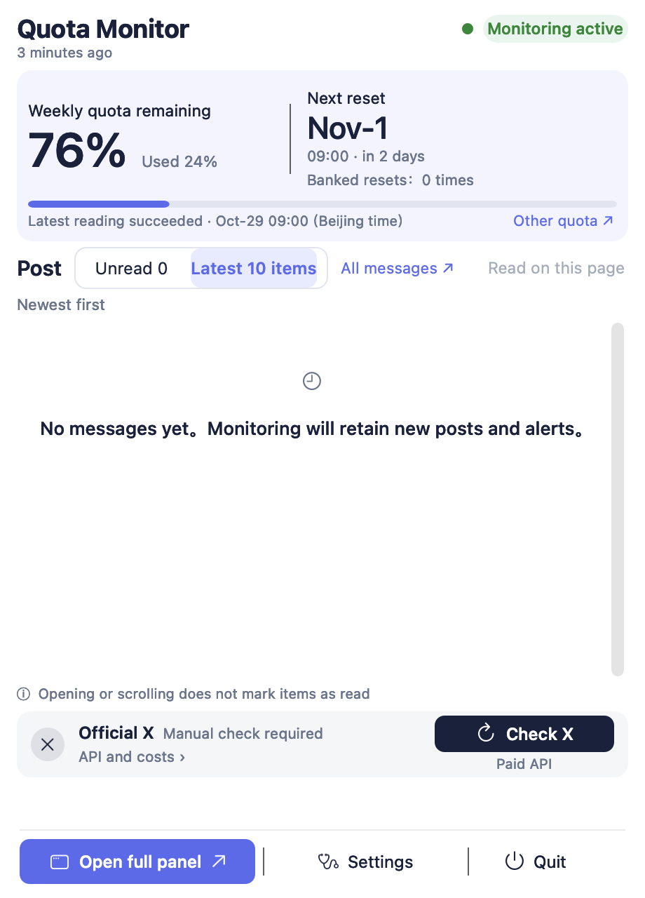

# Codex Quota Monitor

Production menu component rendered with synthetic records; this is not a live account screenshot.

A free menu bar companion for Codex on macOS. Check local quota, reset windows, public announcements, alerts, and optional public-source analysis in one application.

- Apple Silicon; macOS 13 or later. See tested scope in [Known Issues](docs/KNOWN_ISSUES.md).
- English and Simplified Chinese. Choose Language from the application menu or Settings, then quit and reopen.
- One application with an embedded Python runtime. No Python, Homebrew, Xcode, or separate background installer is required.
- Free for personal and business use. Proprietary source code remains private.
- Paid X queries and AI analysis are optional and disabled on a new installation. Supply your own provider credentials; providers may charge for API usage.
- Independent software, not affiliated with, sponsored by, or endorsed by OpenAI.

Downloads will appear in [Releases](https://github.com/jack1231222/codex-quota-monitor/releases) after final validation. This repository contains distribution materials, documentation, and feedback channels.

See [Installation](docs/INSTALL.md), [Privacy](PRIVACY.md), [FAQ](docs/FAQ.md), [Known Issues](docs/KNOWN_ISSUES.md), [free-use license](FREE_USE_LICENSE.md), and [third-party notices](THIRD_PARTY_NOTICES.md).

Local quota readings and public reset announcements are separate evidence. A public announcement does not prove that your account received extra quota. Failed readings keep the last successful value and its original timestamp.

Report bugs through Issues with versions, redacted steps, and minimal screenshots. Never attach authentication files, account credentials, API keys, complete databases, or personal paths.
